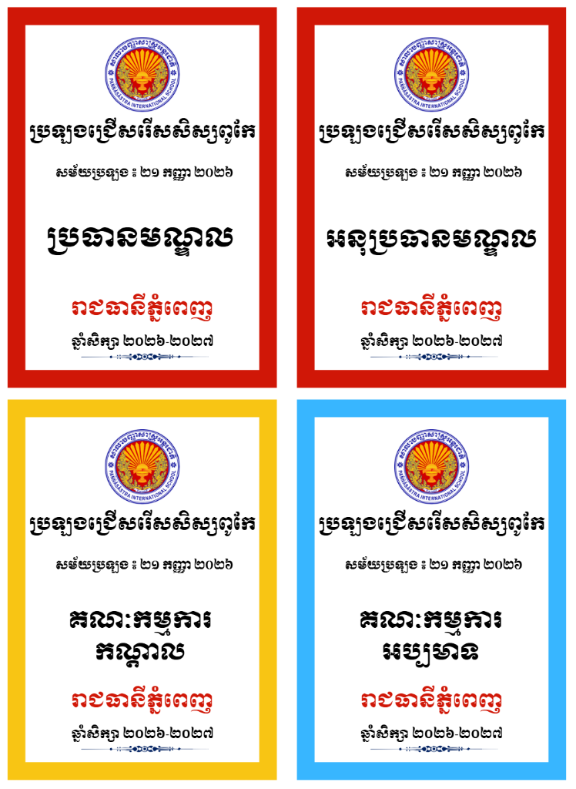

# ប្រព័ន្ធបង្កើតស្លាកសញ្ញាគណៈកម្មការប្រឡង (Exam Committee Badge Generator)

ប្រព័ន្ធគេហទំព័រសម្រាប់បង្កើត និងបោះពុម្ពស្លាកសញ្ញាគណៈកម្មការដំណើរការប្រឡង (ដូចជារូបភាពគំរូផ្លូវការ) លើទំហំក្រដាស A4 ស្តង់ដារ (៤ ស្លាកក្នុងមួយសន្លឹក)។



---

## 🌟 លក្ខណៈពិសេសចម្បង (Key Features)

1. **រចនាបថត្រូវតាមគំរូដើម ១០០% (Exact Match):**
   - គំរូស្លាកសញ្ញា ៤ ក្នុងមួយទំព័រ A4 (ក្រឡាចត្រង្គ ២x២)
   - ស៊ុមពណ៌ក្រាស់តាមតួនាទី (ក្រហម, លឿងទុំ, ខៀវស្រាល, បៃតង, ស្វាយ, ទឹកក្រូច...)
   - គាំទ្រពុម្ពអក្សរខ្មែរផ្លូវការ៖ `Moul` (អក្សរមូលសម្រាប់ចំណងជើង និងតួនាទី), `Kantumruy Pro` និង `Battambang`
   - រូបសញ្ញាឡូហ្គោ និងក្បាច់បន្ទាត់លម្អបុរាណ (Vintage Ornament) ដូចគំរូរូបភាព

2. **ការគ្រប់គ្រងព័ត៌មានប្រឡងងាយស្រួល (Easy Form Controls):**
   - ជ្រើសរើសគំរូកម្មវិធីប្រឡងរហ័ស (សិស្សពូកែ, បាក់ឌុប, ឌីប្លូម, ឆមាស...)
   - បញ្ចូលកាលបរិច្ឆេទសម័យប្រឡង ជាមួយឧបករណ៍បម្លែងជាលេខខ្មែរស្វ័យប្រវត្តិ
   - កំណត់រាជធានី/ខេត្ត និងពណ៌អក្សរ (Default: ក្រហម)
   - ឆ្នាំសិក្សា និងឈ្មោះមណ្ឌលប្រឡង
   - ប្តូររូបភាពឡូហ្គោសាលា/ស្ថាប័នដោយសេរី (គាំទ្រ PNG, JPG, SVG)

3. **ការគ្រប់គ្រងតួនាទី និងចំនួនស្លាក (Role & Quantity Management):**
   - បញ្ចូលចំនួនស្លាកតាមតួនាទីនីមួយៗ (ឧ. ប្រធានមណ្ឌល ១, អនុប្រធានមណ្ឌល ១, គណៈកម្មការកណ្តាល ១, គណៈកម្មការអប្បមាទ ១, អនុរក្ស ៤...)
   - ជ្រើសរើសពណ៌ស៊ុមសម្រាប់តួនាទីនីមួយៗដោយសេរី
   - បន្ថែម, ចម្លង (Duplicate), និងលុបតួនាទីបានយ៉ាងរហ័ស
   - គណនាទំព័រ A4 ដោយស្វ័យប្រវត្តិតាមចំនួនស្លាកសរុប

4. **ការបោះពុម្ពស្ដង់ដារ A4 (Pixel-Perfect A4 Printing):**
   - ចុចប៊ូតុង **"បោះពុម្ព (Print / PDF)"** ដើម្បីបោះពុម្ព ឬរក្សាទុកជា PDF
   - រៀបចំប្លង់ស្វ័យប្រវត្តិ ៤ ស្លាកក្នុងមួយសន្លឹក A4 បញ្ឈរ (Portrait) គ្មានដាច់គែម
   - មានជម្រើសបង្ហាញបន្ទាត់ព្រាងសម្រាប់កាត់ (Cutting Guides) ជួយឱ្យកាត់ក្រដាសបានត្រង់ស្មើល្អ

5. **ដំណើរការដោយមិនបាច់មានអ៊ីនធឺណិត (Offline Ready):**
   - រាល់រូបភាព និងក្បាច់លម្អត្រូវបានបង្កប់ក្នុងកូដ (Embedded Base64) អាចបើកប្រើប្រាស់បានគ្រប់ពេលវេលា

---

## 🚀 របៀបបើកដំណើរការ (How to Run)

### វិធីទី១ ៖ ចុចពីរដងលើឯកសារ `run.bat` (ងាយស្រួលបំផុត)
- គ្រាន់តែ Double-click លើ file `run.bat` នោះវានឹងបើកផ្ទាំងកម្មវិធីក្នុង Browser ដោយស្វ័យប្រវត្តិ។

### វិធីទី២ ៖ បើកឯកសារ `index.html`
- ចុចកណ្ដុរពីរដងលើ `index.html` ដើម្បីបើកក្នុង Google Chrome, Microsoft Edge ឬ Firefox។

### វិធីទី៣ ៖ ដំណើរការតាមរយៈ Python
```bash
python run_server.py
```
បន្ទាប់មកបើក Browser ទៅកាន់៖ `http://localhost:8080`

---

## 🖨️ ការណែនាំអំពីការកំណត់បោះពុម្ព (Print Settings)

នៅពេលចុចប៊ូតុង **"បោះពុម្ព (Print / PDF)"** ឬចុច `Ctrl + P` ៖
1. **Destination ៖** ជ្រើសរើសម៉ាស៊ីនបោះពុម្ព ឬ `Save as PDF`
2. **Pages ៖** All (ទាំងអស់)
3. **Layout ៖** `Portrait` (បញ្ឈរ)
4. **Paper size ៖** `A4`
5. **Margins ៖** `None` (គ្មាន) ឬ `Default`
6. **Options ៖** ធិកលើ **`Background graphics`** (សំខាន់បំផុត ដើម្បីឱ្យចេញពណ៌ស៊ុម និងរូបភាព)

---

## 📁 រចនាសម្ព័ន្ធឯកសារ (Project Structure)

```text
Examination Committee/
├── index.html            # ផ្ទាំងកម្មវិធីចម្បង (Main UI)
├── style.css             # កូដកំណត់ទម្រង់ និងប្លង់បោះពុម្ព A4
├── app.js                # តក្កវិជ្ជានៃកម្មវិធី (Application Logic & State)
├── assets.js             # រូបភាព និងក្បាច់លម្អបង្កប់សម្រាប់ Offline
├── run_server.py         # Local Web Server
├── run.bat               # ផ្លូវកាត់បើកកម្មវិធីលើ Windows
├── assets/
│   ├── logo.png          # រូបសញ្ញាឡូហ្គោគំរូ
│   ├── divider.png       # ក្បាច់បន្ទាត់លម្អគំរូ
│   └── sample.png        # រូបភាពគំរូដើម
└── README.md             # ឯកសារណែនាំ
```
